# 🔗 PhantomClick
### 🔎 *Investigate Before You Interact*


> **AI-Driven Scam Link Forensics**

PhantomClick is an intelligent scam detection and forensic investigation platform that helps users identify and analyze fraudulent SMS messages, phishing URLs, and scam attempts before falling victim to them. Using AI-powered analysis, secure sandboxing, and forensic evidence generation, PhantomClick transforms scam detection into actionable cyber intelligence.

## 🚨 The Problem

India faces a **₹10,000+ Crore annual loss** from digital fraud (NCRB). SMS scams exploit:
- **Financial Fraud**: Fake KYC updates, reward claims, account suspension alerts
- **Government Impersonation**: Fake electricity bills, traffic challans, tax refunds
- **Psychological Pressure**: Urgent messages like "30 minutes left", "Account blocked"

**Current Protection Gaps:**
- ⚡ Detection lag as scam numbers rotate hourly
- 🎭 Perfect impersonation of trusted banks (SBI, HDFC, ICICI)
- ⚠️ Generic warnings without proof or explanation
- 📋 No way to safely verify or collect evidence for reporting


[](https://www.loom.com/share/27f3c840b1994dfcaa0be6a5f2a5d733)

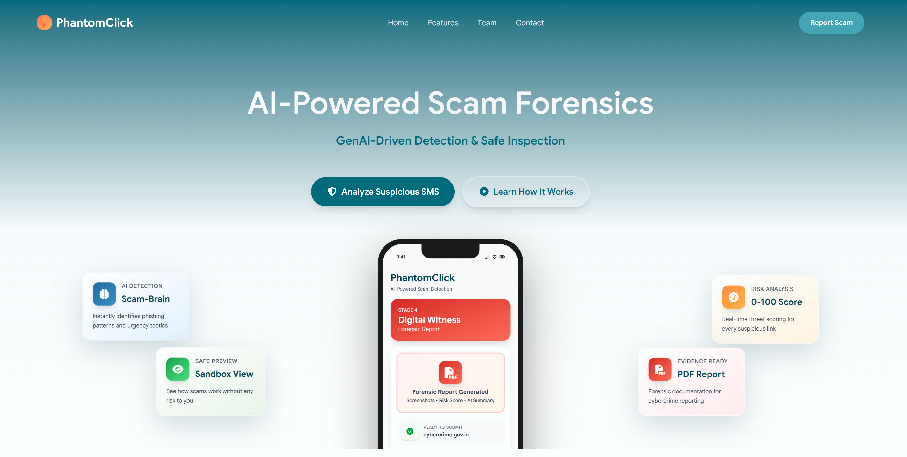
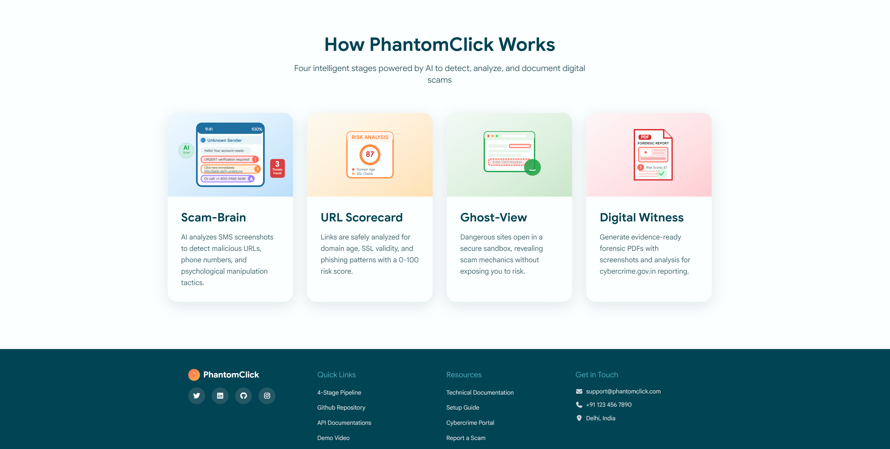


## ✨ Features

### 🧠 Stage 1: ScamBrain - OCR & Psychographic Analysis
Extract intelligence from suspicious SMS screenshots using advanced text recognition and psychological pressure mapping.

**Capabilities:**
- **OCR Processing**: Automatically extracts text, URLs, and phone numbers from SMS images
- **Psychographic Analysis**: Detects urgency, manipulation tactics, and emotional pressure
- **AI Categorization**: Classifies scam type (financial fraud, government impersonation, etc.)
- **Visual Heatmap**: Color-coded pressure mapping to visualize threat psychology

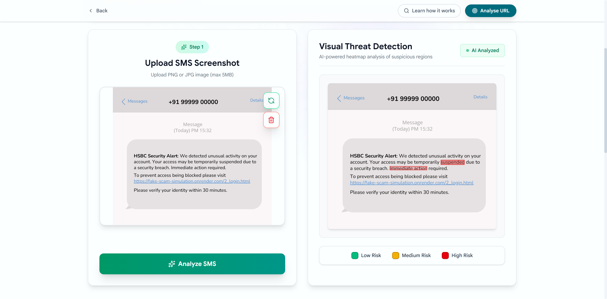
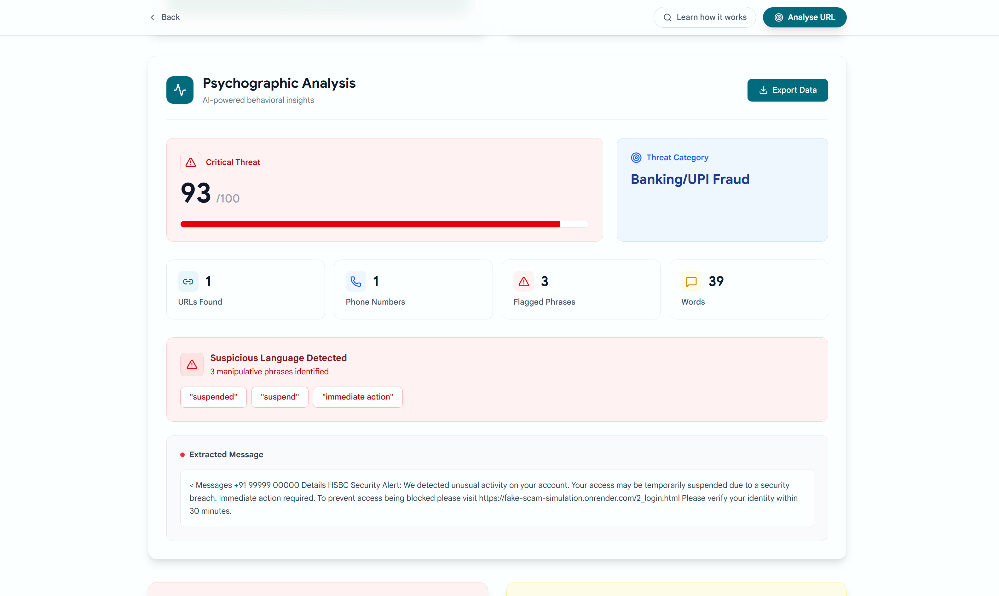

---

### 🔍 Stage 2: DNA of Phishing URL - Advanced Risk Scoring
Multi-layered URL analysis combining heuristics and machine learning to detect malicious patterns.

**Detection Methods:**

#### 1. **Look-Alike Detection**
- Uses Levenshtein Distance Algorithm
- Compares against 57 legitimate Indian domains
- Detects typosquatting (e.g., `sbi-kyc-update.in` vs `sbi.co.in`)
- **Risk Weight**: 30%

#### 2. **Domain Age Analysis**
- WHOIS lookup for creation date
- Age-based risk scoring:
  - < 3 days = 100% risk
  - < 30 days = 70% risk
  - < 1 year = 40% risk
- **Risk Weight**: 25%

#### 3. **URL Entropy Analysis**
- Shannon entropy calculation
- Measures randomness in URL structure
- Entropy scale:
  - \> 4.5 = 80% risk (high randomness)
  - 4.0-4.5 = 60% risk (moderate)
- **Risk Weight**: 15%

#### 4. **Machine Learning Prediction**
- Random Forest classifier (100 trees)
- Trained on PhishTank datasets + legitimate Indian domains
- 18 extracted features per URL
- **Performance**: 99.84% accuracy (9984 TP, 13 TN, 1 FP, 3 FN)

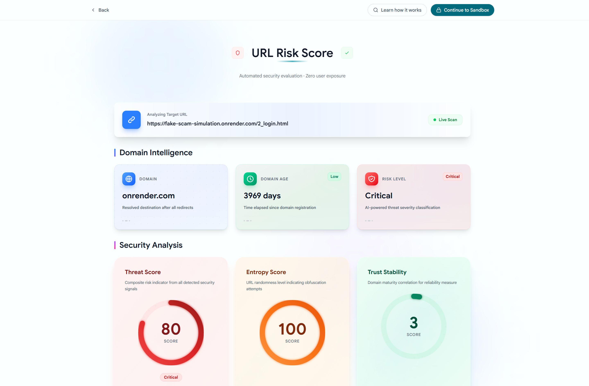

---

### 🔒 Stage 3: Secure Snapshot - Isolated Website Investigation
Zero-trust execution environment that safely opens and interacts with suspicious links.

**How It Works:**
- **Disposable Sandbox**: Playwright + Chromium headless browser in isolated Docker environment
- **AI-Powered Interaction**: Gemini Vision identifies and interacts with form fields using synthetic data
- **Forensic Capture**: Screenshots, DOM snapshots, network logs, and redirect chains
- **Zero User Exposure**: Link never touches user's device

**Threats Detected:**
- Credential theft attempts
- OTP interception
- Malware distribution
- Unauthorized redirects
- Data exfiltration

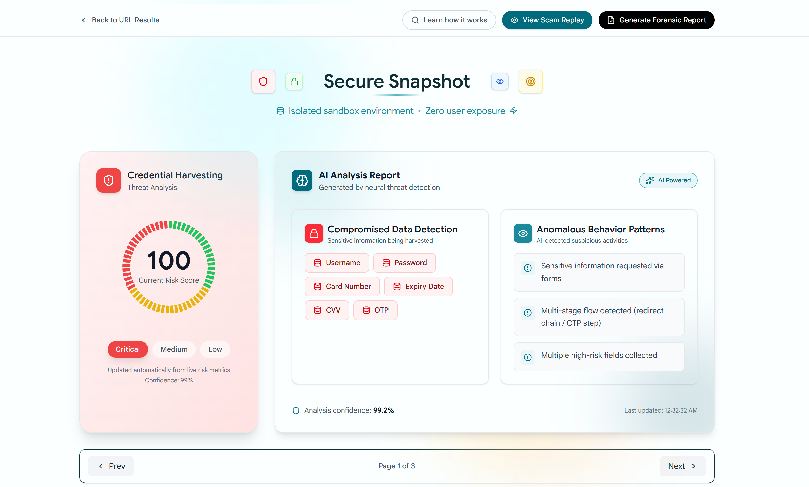
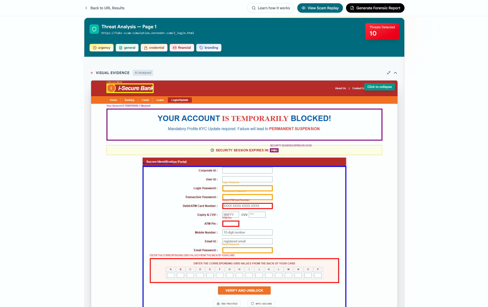
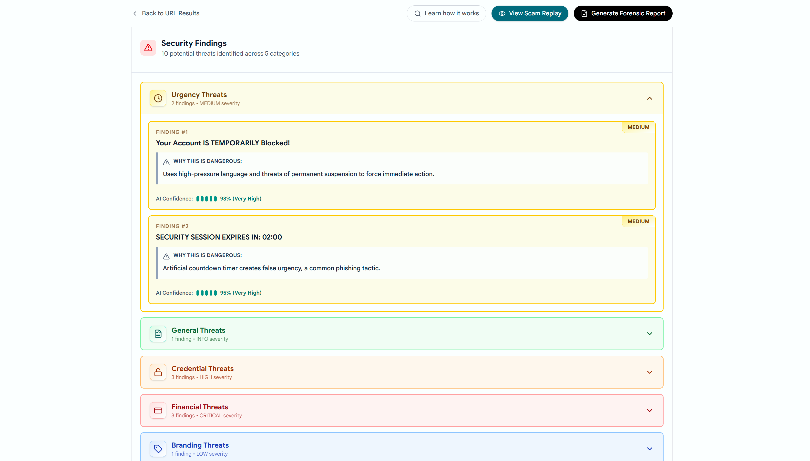

---

### 🎬 Stage 4: Scam Replay - Interactive Threat Visualization
Step-by-step visual reconstruction of the complete scam journey.

**Features:**
- **Timeline Reconstruction**: Shows entire attack flow from first click to data theft
- **User's Perspective**: Displays exactly what the victim would see at each stage
- **Educational Value**: Helps users recognize scam patterns for future awareness
- **Real Screenshots**: Instant visual playback with actual captured evidence

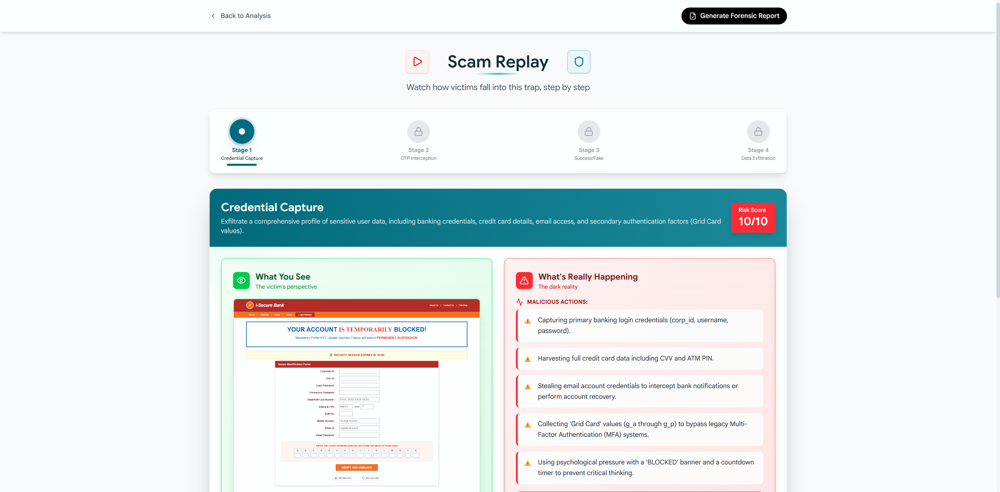
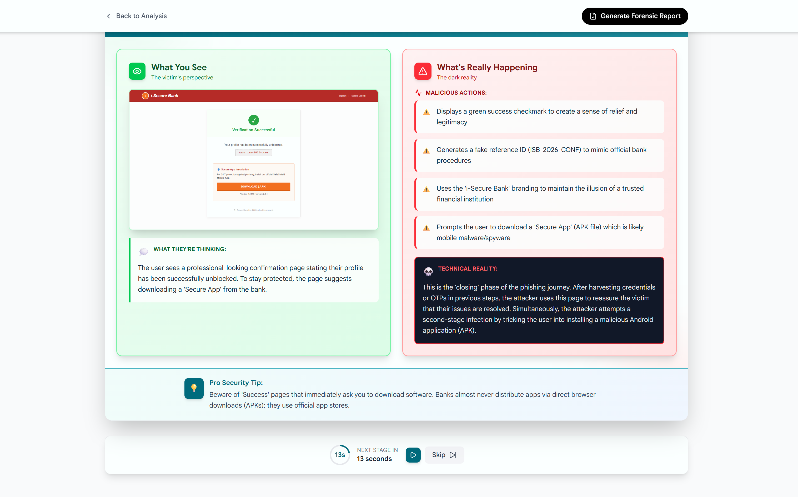

---

### 📄 Stage 5: Automated Forensic Report Generation
Court-ready documentation for cybercrime reporting.

**Report Includes:**
1. **Executive Summary**: High-level threat overview
2. **Incident Details**: Timeline, URLs, and entities involved
3. **Technical Analysis**: Sandbox behavior, network activity, IOCs
4. **Indicators of Compromise**: Domains, IPs, patterns
5. **Impact Assessment**: Risk level and potential damage
6. **Recommendations**: Actionable security guidance

**Technology:**
- Google Gemini Flash for AI-driven narrative synthesis
- PDFKit for standardized forensic document generation
- Ready for submission to National Cyber Crime Reporting Portal (cybercrime.gov.in)

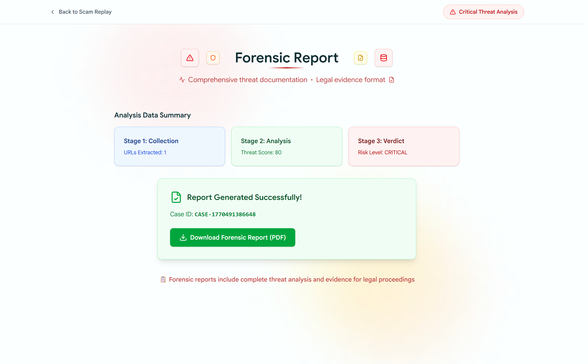
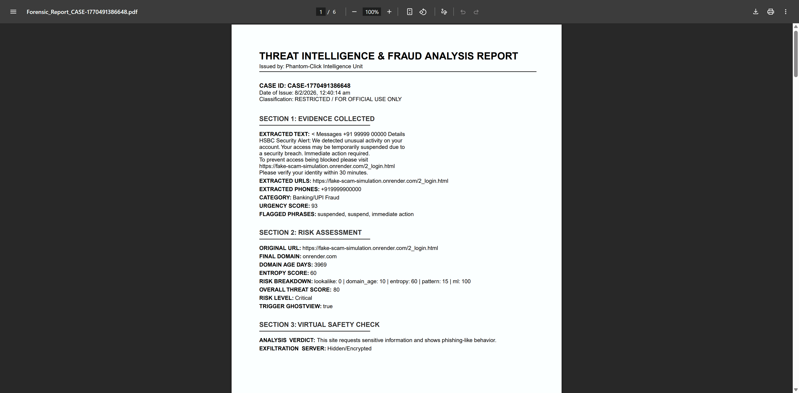

---

## 🏗️ System Architecture

```
┌─────────────────┐
│   Frontend      │  Vite + React
│   (Port 5173)   │
└────────┬────────┘
         │
    ┌────┴────┐
    │         │
┌───▼────┐ ┌──▼─────────┐
│ Node   │ │  Python    │
│ Server │ │  Server    │
│ (5000) │ │  (8001)    │
└───┬────┘ └──┬─────────┘
    │         │
    │    ┌────▼─────┐
    │    │Tesseract │
    │    │   OCR    │
    │    └──────────┘
    │
┌───▼──────────────┐
│   Playwright     │
│   Sandbox        │
│   + Gemini AI    │
└──────────────────┘
```

---

## 🚀 Quick Start

### Minimal System Requirements

| Component | Requirement |
|-----------|-------------|
| **Node.js** | v18.0.0 or higher |
| **Python** | v3.8 or higher |
| **RAM** | 4GB minimum (8GB recommended) |
| **Storage** | 2GB free space |
| **OS** | Windows 10+, macOS 10.15+, Ubuntu 20.04+ |

### Prerequisites Checklist

- [ ] Node.js 18+ installed
- [ ] Python 3.8+ installed
- [ ] Tesseract OCR installed
- [ ] Google Gemini API key obtained
- [ ] Git installed

---

## 📦 Installation

### 1. Clone the Repository

```bash
git clone <repo-url>
```

### 2. Install Tesseract OCR

#### Windows
1. Download: [tesseract-ocr-w64-setup-5.5.0.20241111.exe](https://github.com/UB-Mannheim/tesseract/wiki)
2. Install to: `C:\Program Files\Tesseract-OCR`
3. Add to PATH: `C:\Program Files\Tesseract-OCR`
4. Verify: `tesseract --version`

#### macOS
```bash
brew install tesseract
```

#### Linux (Ubuntu/Debian)
```bash
sudo apt update
sudo apt install tesseract-ocr
```

### 3. Setup Backend Services

#### Python Backend (OCR Service)

```bash
cd server/python-server

# Create virtual environment
python -m venv venv

# Activate virtual environment
# Windows:
venv\Scripts\activate
# macOS/Linux:
source venv/bin/activate

# Install dependencies
pip install -r requirements.txt
```

**Create `.env` file:**
```env
GEMINI_API_KEY=your_gemini_api_key_here
```

**Run server:**
```bash
uvicorn main:app --host 0.0.0.0 --port 8001 --reload
```

---

#### Node Backend (Automation & AI Service)

```bash
cd server/node-server

# Install dependencies
npm install
```

**Create `.env` file:**
```env
PORT=5000
PYTHON_URL=http://localhost:8001
GOOGLE_API_KEY=your_gemini_api_key_here
```

**Run server:**
```bash
# Development (with auto-reload)
npm run dev

# Production
npm start
```

---

### 4. Setup Frontend

```bash
cd client

# Install dependencies
npm install
```

**Create `.env` file:**
```env
VITE_NODE_API=http://localhost:5000
VITE_PYTHON_API=http://localhost:8001
```

**Run application:**
```bash
# Development
npm run dev

# Production build
npm run build
npm run preview
```

---

## 🎯 Usage

1. **Access the application**: Open `http://localhost:5173` in your browser
2. **Upload SMS screenshot**: Drag and drop or select an image of a suspicious SMS
3. **View Risk Analysis**: Get instant psychographic analysis and risk score
4. **Trigger Sandbox Investigation**: For high-risk URLs (score ≥ 60)
5. **Review Scam Replay**: See step-by-step visualization of the attack
6. **Download Forensic Report**: Generate PDF evidence for cybercrime reporting

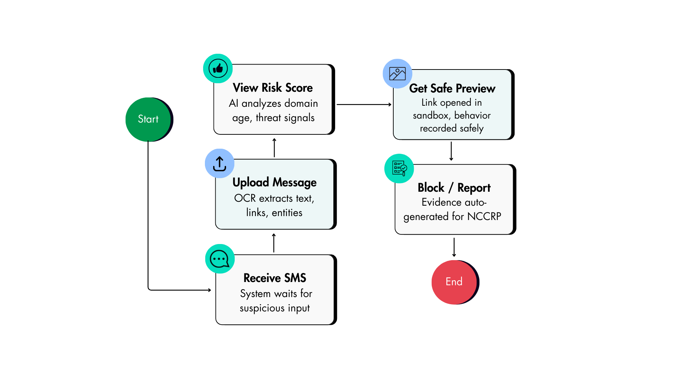

---

## 🛠️ Technology Stack

### Frontend
- **Framework**: React + Vite
- **State Management**: React Hooks
- **HTTP Client**: Axios
- **Styling**: Tailwind CSS / Custom CSS

### Backend (Node)
- **Runtime**: Node.js + Express
- **Browser Automation**: Playwright (Chromium)
- **AI Integration**: Google Generative AI (Gemini)
- **Proxy**: http-proxy-middleware
- **PDF Generation**: PDFKit

### Backend (Python)
- **Framework**: FastAPI
- **OCR Engine**: Pytesseract + Tesseract
- **Image Processing**: PIL/Pillow
- **Async Support**: uvicorn

### Machine Learning
- **Model**: Random Forest (100 trees)
- **Features**: 18 URL-based risk signals
- **Training Data**: PhishTank + 57 legitimate Indian domains
- **Performance**: 99.84% accuracy

---

## 🔗 Real-World Applications

- **Banking & Mobile Apps**: Scan suspicious links before login/transactions
- **UPI & Digital Payments**: Detect fake payment requests and KYC scams
- **SMS Platforms**: Real-time message screening
- **Cybercrime Investigation**: Generate forensic evidence for NCCRP
- **Digital Literacy Programs**: Educational demonstrations of scam tactics

---

## 🌟 Novelty & Innovation

### What Makes PhantomClick Unique?

1. **Live Threat Investigation**: Actively opens links in isolated sandboxes
2. **Explainable Scam Replay**: Visual step-by-step attack reconstruction
3. **Intent-Aware AI**: Detects psychological manipulation, not just keywords
4. **Evidence-Ready Forensics**: Automated report generation for law enforcement

---

## 🚀 Future Scope

- **SDK Integration**: Plug-and-play security for UPI and banking apps
- **Telecom-Level Protection**: SMS gateway filtering before delivery
- **Real-Time Forensics Engine**: Dedicated tool for police and cybercrime units
- **National Awareness Programs**: Educational platform for digital literacy

---

## 🐛 Troubleshooting

### Tesseract not found
```bash
# Verify installation
tesseract --version

# Add to PATH (Windows)
setx PATH "%PATH%;C:\Program Files\Tesseract-OCR"
```

### Port already in use
```bash
# Find and kill process (Windows)
netstat -ano | findstr :5000
taskkill /PID <PID> /F

# macOS/Linux
lsof -ti:5000 | xargs kill -9
```

### Playwright installation issues
```bash
# Install browsers
npx playwright install chromium
```

---

## 👥 Developed By

- **Ananya Sharma**
- **Atreyi Prasad**
- **Divyanshi Pal**
- **Avwal Kaur**

---

## ⚖️ Disclaimer

PhantomClick is an educational and research tool designed for scam detection and awareness. Users should:
- Never interact with suspicious links on their personal devices
- Report confirmed scams to cybercrime.gov.in
- Use the tool responsibly and ethically
- Not use it for unauthorized security testing

---

**Made with ❤️ for a safer digital India**


---

*Last Updated: February 2026*
